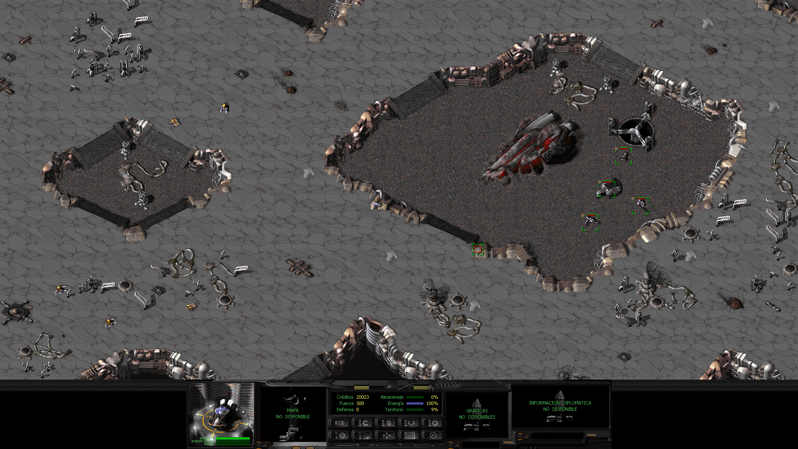
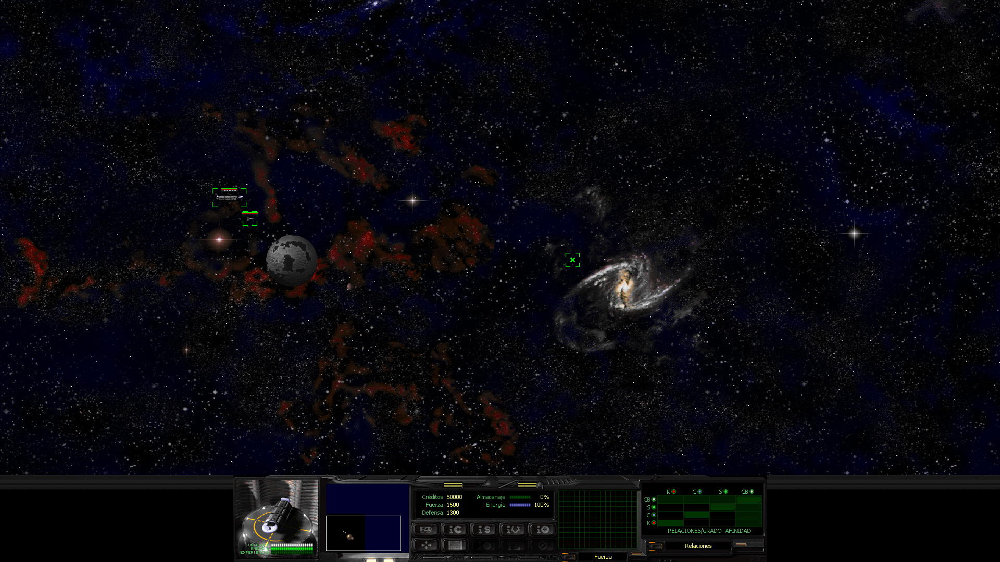

# Space Clash Enhanced

Instaladores para jugar **Space Clash: The Last Frontier** (Dinamic Multimedia / Enigma Software, 1999)
en computadoras actuales: **Linux** (CachyOS / Arch, Ubuntu / Debian) y **Windows 10 / 11**.

- Pantalla completa en 4:3, escalada y centrada en monitores modernos (1080p, 1440p…).
- Vídeos de introducción y finales a pantalla completa sin deformar (el instalador lo pregunta).
- No hace falta el CD físico: alcanza con la imagen del disco (`.bin` + `.cue`, o `.iso`).
- Corrige errores del juego original que lo hacían colgarse en sistemas modernos (ver
  [qué se corrige](#qué-se-corrige)).
- **Mejoras de juego:** velocidad ajustable con **+** y **−**, zoom con la rueda del ratón, cursor sin
  parpadeo, mucho menos consumo de CPU y **pantalla panorámica** (experimental) con el HUD centrado (ver
  [mejoras durante la partida](#mejoras-durante-la-partida)).

**Parte planetaria a 1920×1080** (la resolución del monitor, por defecto): el mapa ocupa todo el ancho, casi
el triple de área que a 1024×768.



**Mapa estelar a 1920×1080:**



> ⚠️ **Este repositorio NO incluye el juego.** Necesitás tu propia copia del CD original de Space Clash
> (edición española) en forma de imagen de disco. Aquí solo hay instaladores y documentación.

---

## Qué necesitás

1. **La imagen del CD de Space Clash**: un archivo `.bin` con su `.cue`, o un archivo `.iso`.
   Si solo tenés el CD físico, creá la imagen con cualquier programa de copia de CD
   (Windows: [ImgBurn](https://www.imgburn.com/) → *Crear imagen a partir del disco*;
   Linux: K3b → *Copiar medio → Solo crear imagen*).
2. **Unos 3 GB libres** en disco.
3. **Conexión a internet** durante la instalación (para descargar
   [cnc-ddraw](https://github.com/FunkyFr3sh/cnc-ddraw), que permite la pantalla completa escalada).

## Descargar

1. **[⬇️ Descargar SpaceClashEnhanced.zip](https://github.com/blackknightr89/SpaceClashEnhanced/releases/latest/download/SpaceClashEnhanced.zip)**
   (última versión). También está en la página de
   [Releases](https://github.com/blackknightr89/SpaceClashEnhanced/releases/latest), dentro de
   *Assets*. Bajá **`SpaceClashEnhanced.zip`**, no los archivos *Source code*.
2. **Descomprimí** el ZIP donde quieras (por ejemplo, en Documentos). Se crea la carpeta
   **`SpaceClashEnhanced`**.
   - Windows: clic derecho sobre el ZIP → **Extraer todo…** → *Extraer*. No ejecutes el instalador desde
     dentro del ZIP sin extraerlo.
   - Linux: clic derecho → *Extraer aquí*.
3. Dentro de `SpaceClashEnhanced` hay una carpeta llamada **`disk`**: **copiá ahí la imagen de tu CD**
   (el `.bin` y el `.cue`, o la `.iso`). El nombre de los archivos no importa.

---

## Instalar en Windows 10 / 11

1. Comprobá que la imagen del juego esté en `SpaceClashEnhanced\disk`.
2. En la carpeta `SpaceClashEnhanced`, hacé **doble clic en `install-spaceclash.cmd`**.
   - Si Windows muestra *"Windows protegió su PC"*: **Más información → Ejecutar de todas formas**.
   - Si pregunta por **DirectPlay**, respondé que sí: el juego lo necesita. Windows pedirá permiso de
     administrador una sola vez.
   - Pregunta si querés **adaptar los vídeos a 4:3** (Enter = sí; descarga ffmpeg, ≈110 MB, si no lo
     tenés). Ver [Al jugar](#al-jugar).
3. Al terminar aparece un acceso directo **"Space Clash"** en el Escritorio y en el menú Inicio.

> Estado: el instalador de Windows fue probado en profundidad, pero **todavía no en un Windows real**.
> Si algo falla, abrí un *issue* (ver [Problemas](#problemas)).

## Instalar en Linux

1. Comprobá que la imagen del juego esté en `SpaceClashEnhanced/disk`.
2. Abrí una terminal **dentro de la carpeta `SpaceClashEnhanced`** (en Dolphin: clic derecho en un
   espacio vacío → *Abrir terminal aquí*; en Archivos de GNOME: clic derecho → *Abrir en una terminal*).
3. Instalá lo necesario (una sola vez; pide tu contraseña). Según tu distribución:
   - **CachyOS / Arch:**
     ```bash
     sudo pacman -S --needed wine 7zip python unzip curl imagemagick ffmpeg gst-plugins-base gst-plugins-good gst-plugins-bad gst-plugins-ugly gst-libav
     ```
   - **Ubuntu 24.04 / Debian** (el juego es de 32 bits y el Wine de Ubuntu necesita los paquetes `:i386`):
     ```bash
     sudo dpkg --add-architecture i386 && sudo apt update
     sudo apt install wine wine64 wine32:i386 7zip python3 unzip curl imagemagick ffmpeg x11-xserver-utils gstreamer1.0-plugins-base:i386 gstreamer1.0-plugins-good:i386 gstreamer1.0-plugins-bad:i386 gstreamer1.0-plugins-ugly:i386 gstreamer1.0-libav:i386
     ```
   - O dejá que lo haga el instalador: en el paso siguiente usá `bash install-spaceclash.sh install --install-deps`.
4. Instalá el juego:
   ```bash
   bash install-spaceclash.sh install
   ```
5. Jugá desde el menú de aplicaciones (**"Space Clash: The Last Frontier"**) o con:
   ```bash
   bash install-spaceclash.sh run
   ```

Probado en **CachyOS** (máquina real) y en **Ubuntu 24.04** (instalación, vídeos, partida y mapa estelar,
en un entorno de prueba sin escritorio; todavía no en un Ubuntu con escritorio). Otras distribuciones:
debería funcionar si instalás los paquetes equivalentes (Wine ≥ 9 con soporte de 32 bits, 7-Zip, Python 3,
unzip, curl, ffmpeg y los plugins de GStreamer).

---

## Al jugar

- **Un clic** salta cada vídeo de introducción. Para no verlos, usá el acceso directo
  **"Space Clash (sin vídeos)"**: arranca directo en el menú principal (los vídeos finales de la campaña
  se siguen viendo; en ese modo, *Introducción* del menú no hace nada). Desde la terminal:
  `~/Games/space-clash/spaceclash.sh --sin-videos` (Linux).
- En el menú principal, la tecla **Esc sale del juego**.
- Las partidas se guardan dentro de la carpeta de instalación:
  - Linux: `~/Games/space-clash/prefix/drive_c/SCLASH/`
  - Windows: `%USERPROFILE%\Games\SpaceClash\SCLASH\`
- **Vídeos:** el juego los estira a toda la pantalla. Para que se vean en 4:3, el instalador puede
  generar una copia adaptada a la resolución de tu monitor, con barras negras a los lados (tarda alrededor
  de un minuto; los originales se conservan). **Lo pregunta al instalar** (respuesta por defecto: sí); al
  reinstalar se conserva lo que elegiste. Si cambiás de monitor, el juego los vuelve a adaptar la próxima
  vez que lo abras, antes de empezar.
  - Linux: necesita `ffmpeg`. Sin preguntar: `--videos fit` o `--videos original`.
  - Windows: descarga ffmpeg si no lo tenés (≈110 MB); todavía no se probó en Windows real. Sin
    preguntar: `-Videos Fit` o `-Videos Original`.

## Mejoras durante la partida

Los instaladores agregan `scenh.dll`, un módulo propio que el juego carga al arrancar y que aplica mejoras
en memoria, sin cambiar la lógica del juego:

- **Velocidad de juego:** **+** acelera y **−** frena (fila de números o teclado numérico): 50 %, 75 %,
  100 %, 150 %, 200 % y 300 %. Se ve un aviso arriba de la pantalla ("VELOCIDAD X2") y se recuerda para la
  próxima vez. Afecta a todo por igual (unidades, producción, reloj de misión). En multijugador queda fija.
- **Zoom con la rueda del ratón** (parte planetaria y mapa estelar): hacia adelante acerca y hacia atrás
  aleja, al instante y sin pantalla negra, sin mover el centro de la vista. Con la pantalla panorámica
  mantiene la proporción (1920×1080 → 1600×900 → 1280×720 → 1024×576); sin ella, 1024×768 → 800×600 →
  640×480. No actúa en pausa ni en multijugador. Con la pantalla panorámica, el zoom funciona con la
  resolución 1024×768 de *Opciones* (la que se usa por defecto); en 640 u 800 avisa en pantalla.
- **Cursor sin parpadeo:** con cnc-ddraw y Wine el cursor del original parpadeaba durante la partida.
- **Sin espera en negro al cambiar de mapa:** al terminar una misión (o empezar la campaña espacial) la
  pantalla quedaba unos 6 segundos en negro antes del mapa estelar o la pantalla de ascenso; ahora pasa en
  alrededor de un segundo. Al ir del mapa estelar a una misión, el negro baja de unos 2,5 s a menos de 1 s.
- **Autoguardado al empezar cada misión** (cuando cerrás los objetivos), en la última ranura de la lista
  (aparece como "AUTO - …"). Si ahí tenés una partida tuya, no la pisa.
- **Guardado y carga rápidos:** **F12** guarda y **Ctrl+F12** carga, en la parte planetaria y en el mapa
  estelar (también en pausa; no con una ventana abierta ni en multijugador). Usa la novena ranura de la
  lista (aparece como "RAPIDA - …") y tampoco pisa una partida tuya.
- **Cámara con las flechas del teclado:** se mueve igual que con el ratón en el borde de la pantalla, en
  la parte planetaria y en el mapa estelar (con una ventana abierta, las flechas siguen sirviendo para sus
  listas).
- **Grupos de selección:** Ctrl+0–9 guarda la selección y 0–9 la recupera (en la parte planetaria ya
  existía; ahora también con las naves del mapa estelar). Pulsando dos veces el número, la cámara va al
  grupo.
- **Menos CPU:** el original ocupaba un núcleo del procesador al 100 % todo el tiempo; ahora descansa
  entre fotogramas cuando sobra tiempo (útil en portátiles), sin cambiar el ritmo del juego.

- **Pantalla panorámica (experimental), activada por defecto:** la partida (planetaria y mapa estelar) a la
  resolución de tu monitor en lugar de 1024×768, con mucho más mapa a la vista. Se detecta al instalar de
  cero; en monitores más grandes que 2560 px de ancho (4K, ultrawide) se usa la mitad exacta para un
  escalado nítido (3840×2160 → 1920×1080). Al reinstalar se conserva lo elegido. Para otro tamaño:
  `--res 1600x900` (Linux) o `-Res 1600x900` (Windows); para el 4:3 original: `--res off` / `-Res off`.
  Los menús siguen en 640×480 y el HUD conserva su tamaño original, centrado abajo (`centrar_hud=0` en
  `scenh.ini` lo deja a la izquierda, como el original). El minimapa de la parte planetaria todavía no
  está probado. Si algo se ve mal, volvé con `--res off`.

Viene compilado en **SpaceClashEnhanced.zip**; si instalás desde una copia del repositorio, el instalador
de Linux lo compila solo si tenés MinGW (`sudo pacman -S mingw-w64-gcc`).

Cada mejora se puede desactivar en `scenh.ini`, en la carpeta de las partidas. Para instalar sin ellas:
`--no-runtime` (Linux) o `-NoRuntime` (Windows). Lo que se aplicó queda registrado en `scenh.log`.

## Ajustar la imagen

Se cambian volviendo a ejecutar el instalador con la opción (tus partidas se conservan):

| Qué | Linux (`bash install-spaceclash.sh install …`) | Windows (`install-spaceclash.cmd …`) |
|---|---|---|
| Resolución del juego (más área visible del mapa). Una instalación nueva ya queda en 1024 | `--game-res 640\|800\|1024` | `-GameRes 640\|800\|1024` |
| Escalado | `--scaling fit` (llena el alto) · `--scaling integer` (múltiplo exacto, más nítido, más borde) | `-Scaling Fit\|Integer` |
| Filtro de escalado | `--filter auto\|nearest\|sharp\|smooth\|xbr\|crt` | `-Filter Auto\|Nearest\|Sharp\|Smooth\|Xbr\|Crt` (requiere `-Renderer opengl`) |
| Vídeos | `--videos fit\|original` | `-Videos Fit\|Original` |

Recomendado: 1024×768, la resolución con la que queda una instalación nueva. Si actualizás una instalación
anterior que estaba en otra resolución, usá `--game-res 1024` (Windows: `-GameRes 1024`). En 4K, además,
escalado entero (`--scaling integer` / `-Scaling Integer`). En Linux el renderer por defecto es `opengl`;
los filtros no tienen efecto con `--renderer gdi`.

## Vídeos en alta definición con IA (opcional)

Los vídeos originales son de 320×240. Con una IA de escalado (Real-ESRGAN) quedan bastante más nítidos y
sin los bloques del MPEG: logos, intro y finales. Se generan **en tu computadora, a partir de tu copia**
del juego, y **una sola vez**: tardan unos 10 minutos con una placa NVIDIA (horas sin GPU) y ocupan
~1,5 GB.

Requisito: Python 3.10 o más nuevo con **PyTorch** (con CUDA para usar la GPU; ver
[pytorch.org](https://pytorch.org)). Lo demás lo resuelve el instalador.

- **Al instalar (Linux):** si elegiste adaptar los vídeos y hay PyTorch, el instalador pregunta si querés
  escalarlos (por defecto, no). Si respondés que sí, crea un entorno en `~/.local/share/spaceclash-venv` con lo que falta
  (spandrel) y los escala.
- **Al instalar (Windows):** pregunta si elegiste adaptar los vídeos y hay un Python con PyTorch y
  spandrel (`pip install torch spandrel numpy`).
- **En cualquier momento:** `~/.local/share/spaceclash-venv/bin/python tools/upscale-videos.py` (Linux,
  una vez creado el entorno; otra carpeta: `--root DIR`) o
  `py tools\upscale-videos.py --root %USERPROFILE%\Games\SpaceClash` (Windows). El juego usa los vídeos
  nuevos cuando están los 7, la próxima vez que lo abras.
- Modelos: `--model general` (por defecto, el más fiel), `general-sharp` (más nítido) o `x4plus` (texturas
  más marcadas, ~12 veces más lento).
- Sin preguntas (instalaciones automáticas): `--videos-ai general|off` (Windows: `-VideosAi General|Off`).

Desinstalar borra también estos vídeos; se pueden volver a generar.

## Actualizar

1. Cerrá el juego.
2. Bajá la versión nueva desde [Releases](https://github.com/blackknightr89/SpaceClashEnhanced/releases/latest)
   (mismo enlace de [Descargar](#descargar)) y descomprimila.
3. Ejecutá de nuevo el instalador desde la carpeta nueva (`install-spaceclash.cmd` o
   `bash install-spaceclash.sh install`).

**Tus partidas y opciones se conservan**, y no hace falta volver a copiar la imagen del CD: el juego ya
instalado tiene su propia copia. Después podés borrar la carpeta descargada anterior.

## Desinstalar

- Windows: `install-spaceclash.cmd -Command uninstall`
- Linux: `bash install-spaceclash.sh uninstall`

Antes de borrar, el desinstalador **copia tus partidas** (y las opciones del juego) a una carpeta junto a
la instalación: `~/Games/space-clash-partidas-<fecha>` en Linux, `%USERPROFILE%\Games\SpaceClash-partidas-<fecha>`
en Windows. Si después volvés a instalar, el instalador encuentra la copia más reciente y te ofrece
restaurarla. Si no querés la copia: `--no-backup` (Linux) o `-NoBackup` (Windows).

## Problemas

1. Ejecutá el diagnóstico:
   - Windows: `install-spaceclash.cmd -Command doctor`
   - Linux: `bash install-spaceclash.sh doctor`
2. Buscá el síntoma en esta tabla:

   | Síntoma | Qué hacer |
   |---|---|
   | *"No encontré la imagen del juego"* | Copiá el `.bin` + `.cue` (o la `.iso`) en la carpeta `disk` |
   | *"Para jugar a Space Clash debes ejecutar SC.EXE"* o el juego se cuelga | Cerrá el juego y volvé a ejecutar el instalador (reaplica los parches) |
   | *"El juego está abierto. Cerralo antes de instalar"* | Cerrá el juego. Si quedó colgado, en Linux: `WINEPREFIX=~/Games/space-clash/prefix wineserver -k`; en Windows: Administrador de tareas → finalizar `CLASH.EXE`/`SPACE.EXE` |
   | Pantalla negra (se oye el juego) | Linux: `bash install-spaceclash.sh install --renderer gdi` · Windows: `install-spaceclash.cmd -Renderer gdi` |
   | Vídeos en blanco | Windows: probá `install-spaceclash.cmd -Display Native` |
   | Vídeos estirados a lo ancho | Reinstalá con `--videos fit` (Linux, con `ffmpeg` instalado) o `install-spaceclash.cmd -Videos Fit` (Windows) |
   | Vídeos con barras negras dobles o achicados (Windows con `-Videos Fit`) | Reinstalá sin esa opción y abrí un *issue* |
   | El juego queda minimizado | Linux: no desactives el escritorio virtual (`SC_VDESKTOP=0`) |
   | Aparece en el otro monitor | Movelo con Win/Meta + Shift + flecha |
   | *"la ejecución de scripts está deshabilitada"* (Windows) | Usá `install-spaceclash.cmd`, no el `.ps1` directamente |
   | Aviso de DirectPlay (Windows) | Aceptá instalarlo: el juego lo necesita |
   | El juego se cierra apenas arranca (Wine informa un error en `00414D6D`) | El juego necesita un dispositivo de sonido. Comprobá que el sonido de tu sistema funcione (PipeWire o PulseAudio) |
   | Ubuntu: *"Introduce el CD en la unidad"* o el juego no llega a abrirse | Actualizá a la última versión de este proyecto y volvé a ejecutar el instalador |

3. Si no se resuelve, abrí un **issue** en este repositorio con la salida del diagnóstico y, si el juego
   se colgó, el informe de error. En Linux, Wine ofrece guardarlo como `backtrace.txt` en el Escritorio;
   en Windows, mirá `logs\launcher.log` en la carpeta de instalación.

---

## Qué se corrige

El juego original tiene errores que en Windows 95/98/XP no se notaban de casualidad y en sistemas modernos
lo hacen fallar. Los instaladores aplican parches mínimos y verificados a **tu** copia (guardan los
originales como `*.ORIG`):

| Parche | Síntoma que corrige |
|---|---|
| P1 | *"Para jugar a Space Clash debes ejecutar SC.EXE"* al arrancar |
| P2, P3 | Cuelgue de `SPACE.EXE` al iniciar la campaña espacial |
| P4 | Cuelgue al terminar una misión y volver al mapa estelar |

El detalle técnico (direcciones, bytes y causa de cada error) está comentado en los propios instaladores,
en la sección de parches de [`install-spaceclash.sh`](install-spaceclash.sh). Cada parche verifica los
bytes originales y el hash SHA-256 antes y después de aplicarse.

## Estado

| | CachyOS (Wine 11) | Ubuntu 24.04 (Wine 9) | Windows 10/11 |
|---|---|---|---|
| Instalación | ✅ | ✅ ¹ | ✅ probado fuera de Windows · ⏳ falta en Windows real |
| Vídeos, menú, campaña planetaria y espacial | ✅ | ✅ ¹ | ⏳ |
| Pantalla completa escalada 4:3 | ✅ | ✅ ¹ | ⏳ |
| Vídeos a pantalla completa en 4:3 (se pregunta al instalar) | ✅ | ✅ ¹ | ⏳ |
| Vídeos escalados con IA (opcional) | ✅ | ⏳ | ⏳ |
| Guardar/cargar | ✅ | 🟡 ¹ (cargar) | ⏳ |
| Velocidad, zoom y menos CPU (`scenh.dll`) | ✅ | ✅ ¹ | ⏳ |
| Pantalla panorámica (experimental, por defecto; `--res off` la quita) | 🟡 | 🟡 ¹ | ⏳ |
| Multijugador LAN | ⏳ | ⏳ | ⏳ |

¹ Probado en un entorno de prueba de Ubuntu 24.04 sin escritorio (pantalla virtual), todavía no en un
Ubuntu con escritorio.

## Próximos pasos

Lo que viene, en orden. Se actualiza con cada versión.

Recién hecho (próxima versión): **guardado y carga rápidos** con F12 y Ctrl+F12, y la **cámara con las
flechas** del teclado. En **v1.8**: Ubuntu /
Debian y el instalador de Windows al día.

1. **Efectos y voces más limpios:** efectos de sonido con más calidad y voces con menos ruido. Será
   opcional: el instalador lo va a preguntar y se conservan los originales.

Más adelante, sin fecha: los parches del juego aplicados en memoria (sin modificar los `.EXE`), música
mejorada con IA, un instalador con ventanas, Steam Deck, partidas por Internet sin VPN y subtítulos para
las voces.

**Se necesita ayuda para probar:** Windows 10/11 en una máquina real, Ubuntu con escritorio, y el
multijugador en red local. Si lo probás, contá cómo te fue en un *issue* (ver [Problemas](#problemas)).

## Créditos y aviso legal

- *Space Clash: The Last Frontier* © 1999 Dinamic Multimedia / Enigma Software Productions. Este proyecto
  no está afiliado a sus autores ni a sus titulares de derechos. **No distribuye ningún archivo del juego**:
  trabaja sobre la copia que aporta el usuario.
- [cnc-ddraw](https://github.com/FunkyFr3sh/cnc-ddraw) (FunkyFr3sh, licencia MIT): se descarga durante la
  instalación.
- [Wine](https://www.winehq.org/) (en Linux).
- Los scripts y la documentación de este repositorio se publican bajo licencia [MIT](LICENSE).

---

### English (short)

Installers to play the Spanish edition of **Space Clash: The Last Frontier** (1999) on modern **Linux**
(CachyOS/Arch, Ubuntu/Debian; via Wine) and **Windows 10/11**. They include scaled fullscreen (widescreen
by default) and binary patches for the original game's crash bugs, plus an in-memory runtime
(`scenh.dll`): mouse-wheel zoom, adjustable game speed with **+**/**−**, autosave at the start of each
mission, selection groups, shorter black screens and much lower CPU usage. **The game is not included**: download **SpaceClashEnhanced.zip** from
[Releases](https://github.com/blackknightr89/SpaceClashEnhanced/releases/latest), extract it, and put
your own CD image (`.bin`/`.cue` or `.iso`) in `SpaceClashEnhanced/disk/`.
Then run `install-spaceclash.cmd` (Windows) or `bash install-spaceclash.sh install` (Linux).
Documentation and installer messages are in Spanish.
